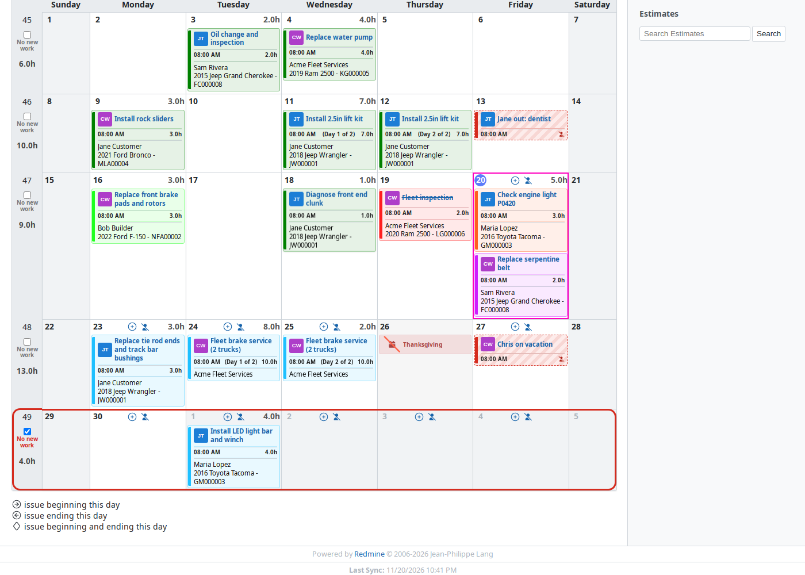
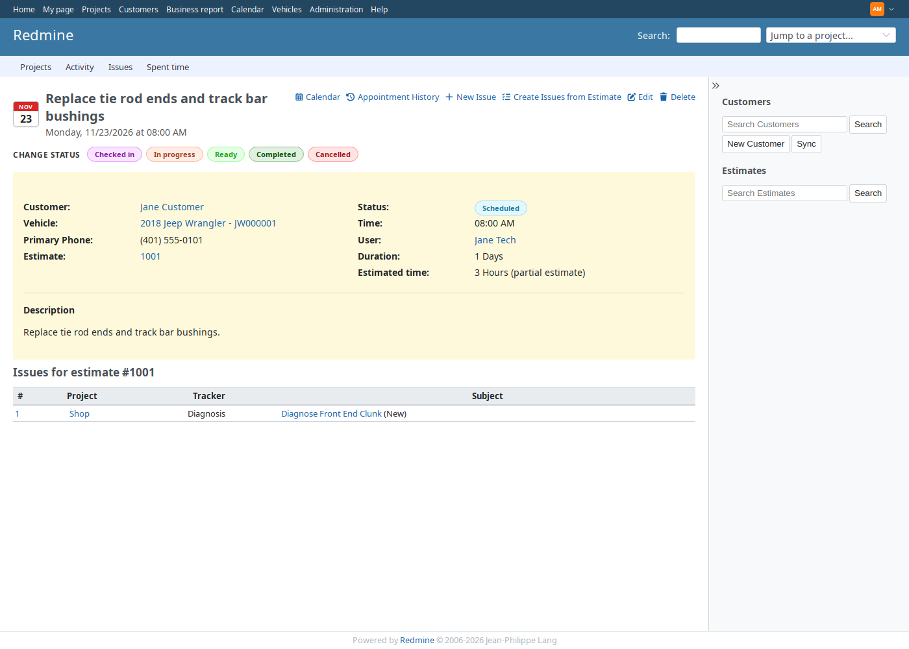
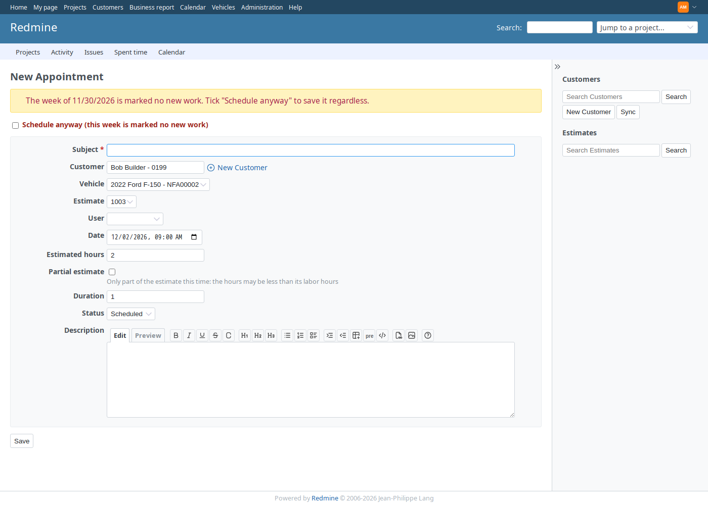
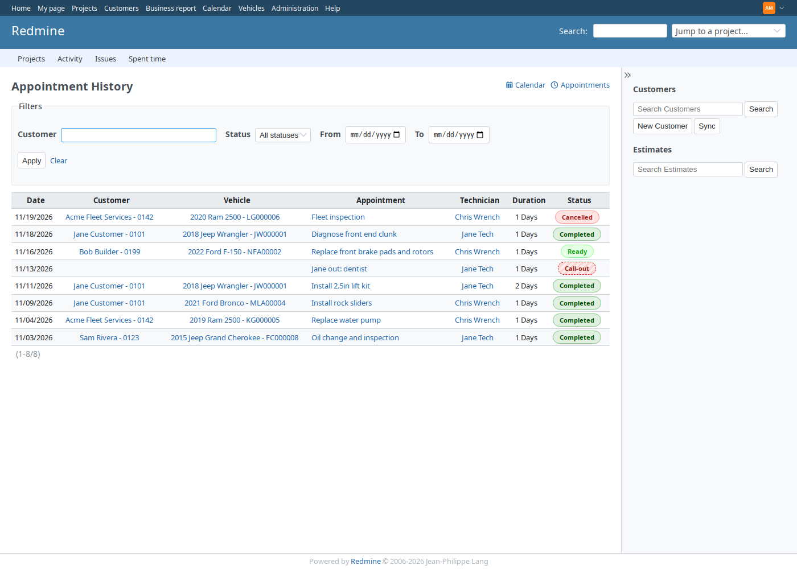
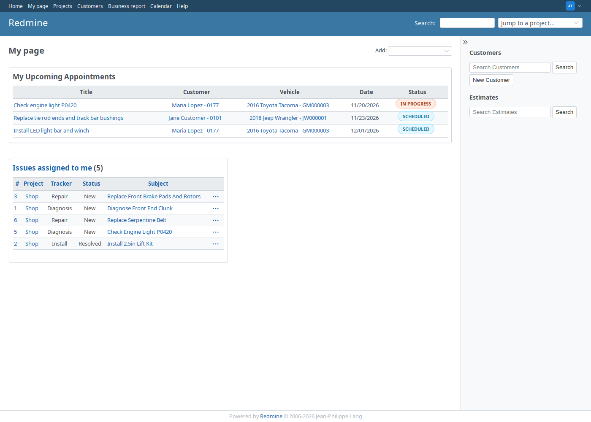
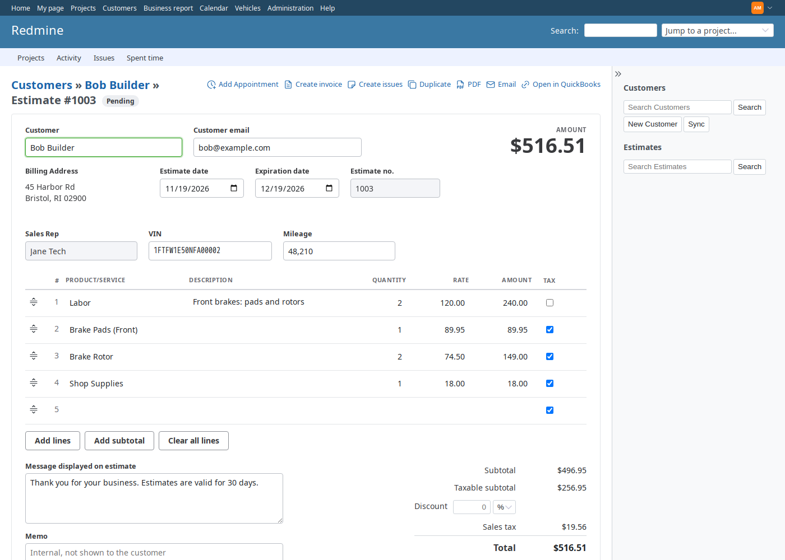
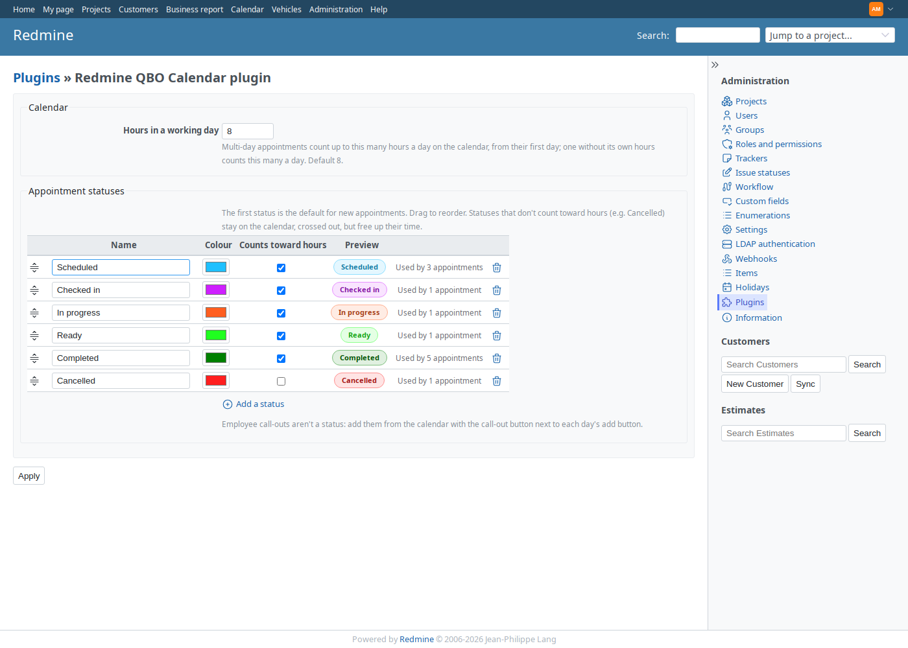
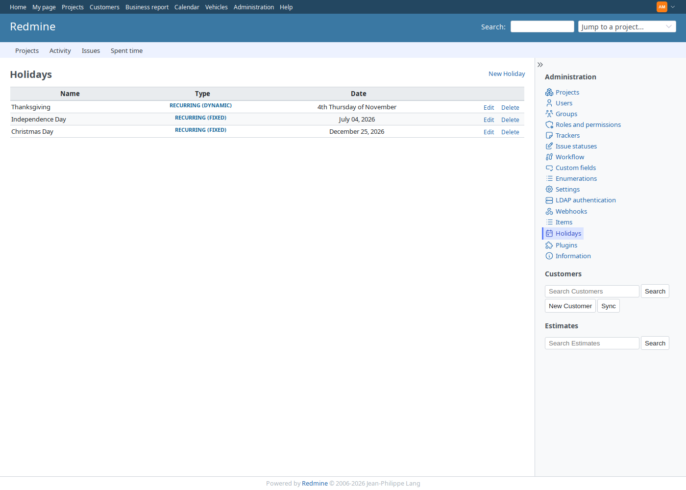

# Redmine QuickBooks Calendar

A plugin for Redmine that extends the functionality of the [Redmine QuickBooks Online](https://github.com/rickbarrette/redmine_qbo) plugin.

This plugin allows for adding customer appointment capability to the Redmine calendar.

---

## Requirements

*   **Redmine:** 6.1+
    
*   **Parent Plugin:** [Redmine QuickBooks Online](https://github.com/rickbarrette/redmine_qbo) (must be installed and configured)

*   Version 2026.11.0 or newer of redmine_qbo: it creates issues from an appointment's estimate and works out the estimate's labor hours.

*   **Optional:** [redmine_qbo_vehicles](https://github.com/rickbarrette/redmine_qbo_vehicles) gives appointments a vehicle. Without it the vehicle is left out of the appointment form, pages and lists.

*   The calendar's icons come from Font Awesome, loaded from `kit.fontawesome.com` (deferred, so pages don't wait for it): browsers need to reach it to show them.
    
---

## Compatibility

| Plugin Version | Redmine Version | Parent Plugin Version |
| --- | --- | --- |
| 2026.8.0+ | 7.0.x | 2026.8.0+ |
| 2026.10.0+ | 7.0.x | 2026.11.0+ |

---

## Features

Add appointments to the redmine calanedar with the abiltiy to attach a QBO customer, QBO Vehicle, QBO Estimate, ect.

* An appointment's hours can't be less than its estimate's labor hours (the quantities of its lines with redmine_qbo's labor products/services). Picking an estimate raises the hours to match. Tick **Partial estimate** to schedule only part of it, and the hours can then be lowered (migration 006).
* The appointment page lists the issues linked to its estimate, and **Create Issues from Estimate** opens redmine_qbo's Create issues page with the appointment's dates, technician and vehicle.
* Estimate pages in redmine_qbo get an **Add appointment** link. Other plugins can add to the new appointment through the `:qbo_calendar_appointment_params, { customer:, estimate_id:, custom_fields: }` hook (e.g. redmine_qbo_vehicles: the vehicle with the estimate's VIN).
* **Appointment statuses** are set up in the plugin's settings (Administration › Plugins › Configure): name, colour, whether the time counts toward the calendar's hours, and order (the first is the default). Renaming a status keeps its appointments; removing one in use asks which status to move them to. Statuses that don't count hours (e.g. Cancelled) stay on the calendar, crossed out.
* **Hours in a working day** (plugin setting, default 8): multi-day appointments count up to this many hours a day on the calendar, from their first day. Issues' estimated hours are spread over their working days from start to due date.
* **No-new-work weeks**: the checkbox under each week number on the calendar flags the week "no new work" and circles it in red. Opening a new appointment in a flagged week warns straight away, and saving one there (or moving or lengthening one into it) is stopped. Users with **Override no-new-work weeks** can tick "Schedule anyway" and save; flagging needs **Flag no-new-work weeks**. Call-outs aren't affected. Upgrading runs migration 005.
* **Filters**: the calendar's issue filters that mean something for appointments narrow them too: **Assignee** (the technician, or a call-out's employee; "me" is you, a group stands for its members), **Customer** (redmine_qbo's customer name filter) and **Project**. A note under the filters says which apply. The others (status, tracker, priority...) are about issues and leave appointments alone.
* **Call-outs**: an employee off work, added with the button next to each day's add button. They show at the top of the day in red stripes, have no customer or status, and never count toward hours. Upgrading (migration 004) turns appointments with the old Call_Out status into call-outs.

---

## Screenshots

All names and figures are made up.

<table>
<tr><td width="50%"><br><sub>The calendar: appointments by status, call-outs, a holiday, hours per day and a no-new-work week</sub></td><td width="50%"><br><sub>An appointment with its customer, vehicle, estimate and the estimate's issues</sub></td></tr>
<tr><td width="50%"><br><sub>A new appointment from an estimate, in a no-new-work week</sub></td><td width="50%"><br><sub>Appointment history</sub></td></tr>
<tr><td width="50%"><br><sub>Upcoming appointments on My page</sub></td><td width="50%"><br><sub>Add Appointment on an estimate</sub></td></tr>
<tr><td width="50%"><br><sub>Appointment statuses and hours in a working day</sub></td><td width="50%"><br><sub>Holidays</sub></td></tr>
</table>

## Installation

1.  **Clone the plugin**
    

Navigate to your Redmine plugins directory:

```bash
cd /path/to/redmine/plugins  
git clone https://github.com/rickbarrette/redmine_qbo_calendar.git  
cd redmine_qbo_calendar  
  
# Optional: checkout a specific version  
git checkout <tag>
```


2.  **Install dependencies**
    
```bash
bundle install
```

3.  **Migrate your database**
    
```bash
bundle exec rake redmine:plugins:migrate RAILS_ENV=production
```

4.  **Restart Redmine**
    

Restart your application server (Puma, Passenger, etc.) to initialize the plugin hooks.

---

## Usage

1. Managing Customer Appointments
    * Viewing the Calendar: Navigate to the Customer Calendar tab within a project or via the top menu to view scheduled customer appointments.
    * Adding Appointments: Click on available days on the calendar grid to schedule a new appointment (restricted by user permissions, working days, and configured holidays).
    * Editing & Deleting: Existing appointments can be modified or removed directly from the calendar interface depending on user privileges.
    * My Page Integration: Users can add the Upcoming Appointments block to their personal My Page dashboard to see their next appointments as the technician, one row per working day.

2. Holidays and Non-Working Days
Administrators can manage the holiday calendar to prevent appointments from being scheduled on non-working days.
    * Go to Administration -> Holidays (or the corresponding holidays menu item).
    * Fixed Holidays: Set specific dates (e.g., December 25th) that recur annually or apply to a single year.
    * Dynamic Holidays: Configure rules for floating holidays (e.g., the 1st Monday of September).
    * Validation: The system automatically blocks appointment creation on standard weekends, non-working days, and defined holidays.

3. Permissions & Global Access
Appointment permissions are configured globally to apply system-wide:
    1. Navigate to Administration -> Roles and permissions.
    2.  Scroll to the global permissions section.
    3.  Assign the following permissions as needed based on user roles (such as Non-member or custom staff roles):
        * View customer appointments
        * Add customer appointments
        * Edit customer appointments
        * Delete customer appointments

---

## License

> The MIT License (MIT)
> 
> Copyright (c) 2026 Rick Barrette
> 
> Permission is hereby granted, free of charge, to any person obtaining a copy of this software and associated documentation files (the "Software"), to deal in the Software without restriction, including without limitation the rights to use, copy, modify, merge, publish, distribute, sublicense, and/or sell copies of the Software, and to permit persons to whom the Software is furnished to do so, subject to the following conditions:
> 
> The above copyright notice and this permission notice shall be included in all copies or substantial portions of the Software.
> 
> THE SOFTWARE IS PROVIDED "AS IS", WITHOUT WARRANTY OF ANY KIND, EXPRESS OR IMPLIED, INCLUDING BUT NOT LIMITED TO THE WARRANTIES OF MERCHANTABILITY, FITNESS FOR A PARTICULAR PURPOSE AND NONINFRINGEMENT. IN NO EVENT SHALL THE AUTHORS OR COPYRIGHT HOLDERS BE LIABLE FOR ANY CLAIM, DAMAGES OR OTHER LIABILITY, WHETHER IN AN ACTION OF CONTRACT, TORT OR OTHERWISE, ARISING FROM, OUT OF OR IN CONNECTION WITH THE SOFTWARE OR THE USE OR OTHER DEALINGS IN THE SOFTWARE.
